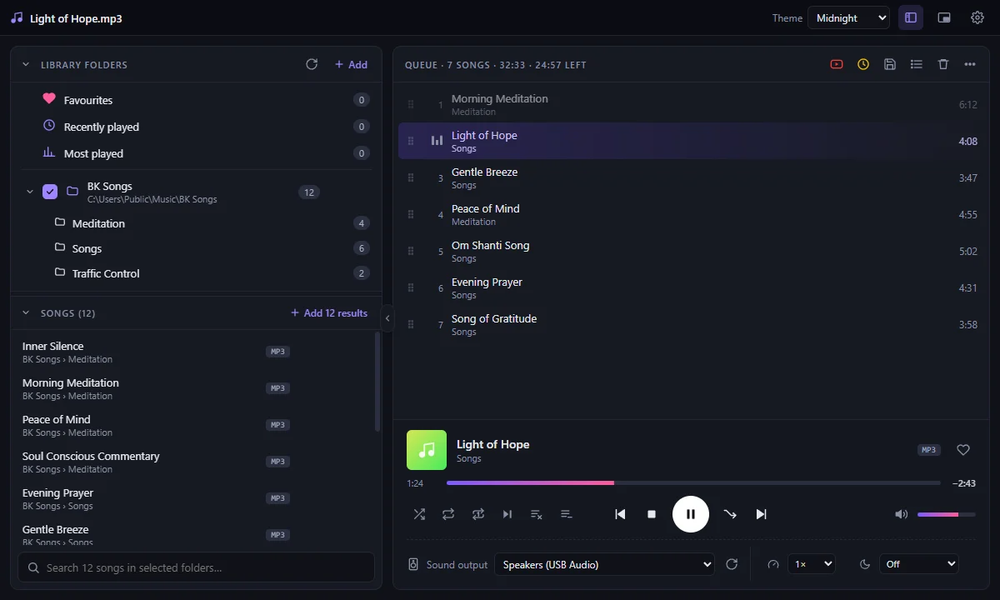
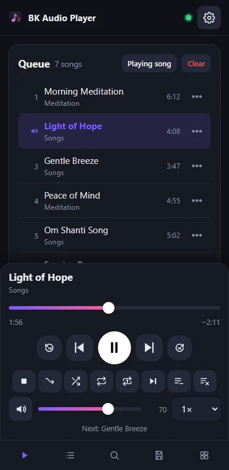
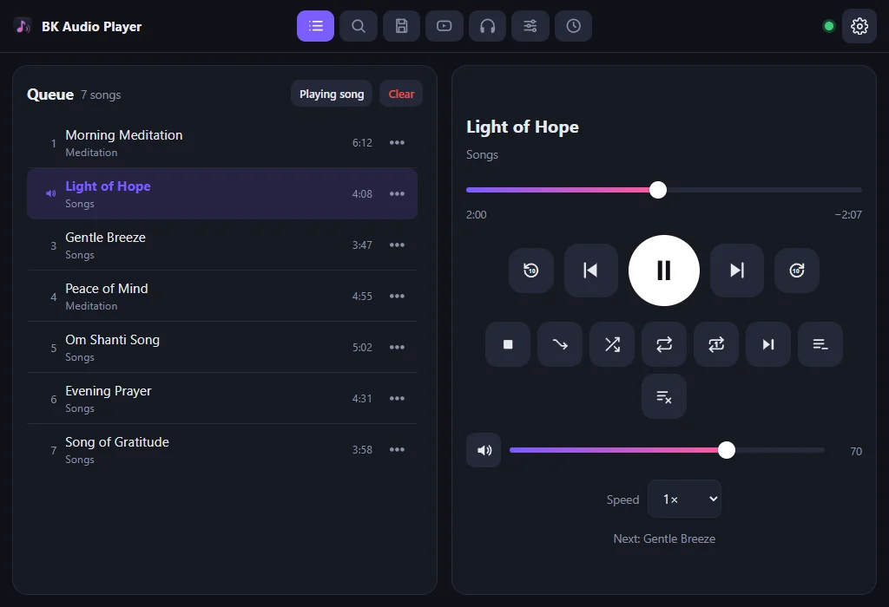
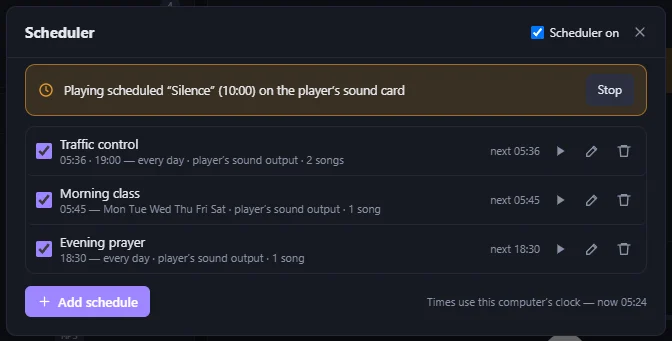
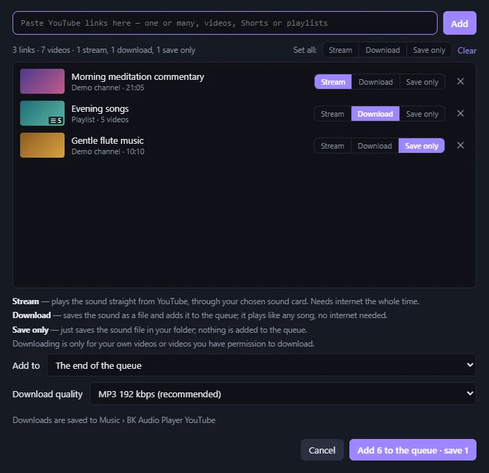
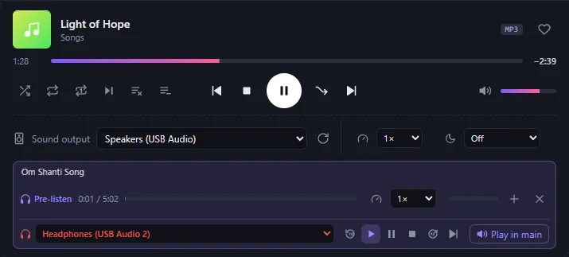
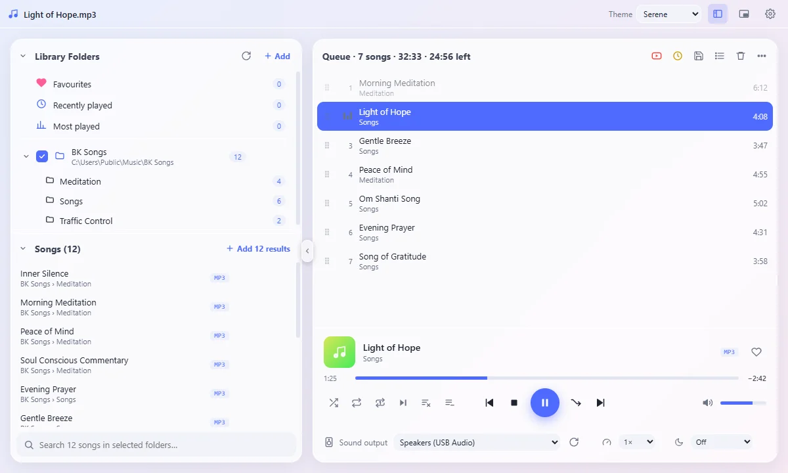

# BK Audio Player

A desktop audio player for **Windows** and **Mac**.

BK Audio Player plays the songs in your own folders — on your computer, a pendrive or a NAS — and the sound of video files and YouTube videos. Put songs in the queue and play them, pre-listen on headphones while the music goes on, let the Scheduler play songs at set times, and control it all from a phone, tablet or Stream Deck. Your files stay where they are: nothing is copied or uploaded.

### **[⬇ Download the newest version](https://github.com/bksrinivasvizag/BK-Audio-Player-Releases/releases/latest)** — for Windows and Mac (Apple chip)

## What it can do

- **Your music library** — add folders from your computer, a pendrive or a NAS; new songs appear by themselves. Search as you type. Favourites, Recently played and Most played.
- **A queue you control** — drag to change the order, *Play next*, select several songs at once, undo a removal. Shuffle, loop, *Stop after each song* for programmes, *Clear at end*, *Remove played*.
- **Smooth playback** — silence or a smooth fade between songs, even out loud and quiet recordings, *Fade out and stop*, speed 0.5× to 2× (the pitch stays the same), sleep timer.
- **Two sound cards** — choose which speakers play, and pre-listen on headphones on a second sound card while the music goes on.
- **YouTube** — stream, download or save the sound of videos and whole playlists, live streams too. Downloads can go to a NAS by themselves.
- **Scheduler** — songs that play by themselves at set times: every day, on chosen days or on a date. The music fades out for them and can carry on afterwards.
- **Phone, tablet and Stream Deck** — scan a QR code and control the player from any phone or tablet on the same Wi-Fi, nothing to install. Simple web commands for Stream Deck and Companion.
- **Comfortable** — a mini player that stays on top, four themes (light and dark), bigger text, a right-click menu in File Explorer / Finder, carries on playing after a restart, updates itself.
- **Help built in** — press **F1** in the player: searchable topics with pictures.

## A closer look

<table>
<tr>
<td width="50%"> <b>Phone remote</b> — the queue and the player on a phone</td>
<td width="50%"> <b>Tablet remote</b> — queue and player side by side</td>
</tr>
<tr>
<td> <b>Scheduler</b> — songs at set times, every day or on chosen days</td>
<td> <b>YouTube</b> — stream, download or save the sound</td>
</tr>
<tr>
<td> <b>Pre-listen</b> — check a song on headphones on a second sound card</td>
<td> <b>Themes</b> — Midnight, Studio, Serene and Serene Dark</td>
</tr>
</table>

## Download

**[Open the newest version](https://github.com/bksrinivasvizag/BK-Audio-Player-Releases/releases/latest)** and download the file for your computer:

| Computer | File |
|---|---|
| **Windows** (install, updates itself) | `BK-Audio-Player-Setup-<version>.exe` |
| **Windows** (portable, no install) | `BK-Audio-Player-Portable-<version>.exe` |
| **Mac with Apple chip** (M1 and newer) | `BK-Audio-Player-<version>-arm64.dmg` |

**Windows:** run the Setup file. If "Windows protected your PC" appears, click *More info → Run anyway*.
After that, new versions download by themselves and are installed when you close the app.

**Mac:** open the .dmg and drag BK Audio Player to Applications. The first time, macOS may say it can't check the app for malicious software: open *System Settings → Privacy & Security* and click *Open Anyway* (once). If it ever says the app is damaged, run in Terminal: `xattr -cr "/Applications/BK Audio Player.app"`. From version 1.5.14 on, new versions download by themselves and are installed when you quit the app.

---

This repository only holds the download files and this page (`latest.yml`, `latest-mac.yml` and `.blockmap` are used by the automatic updates).
